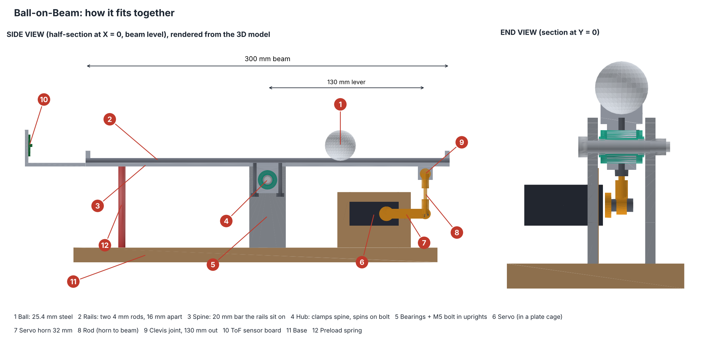
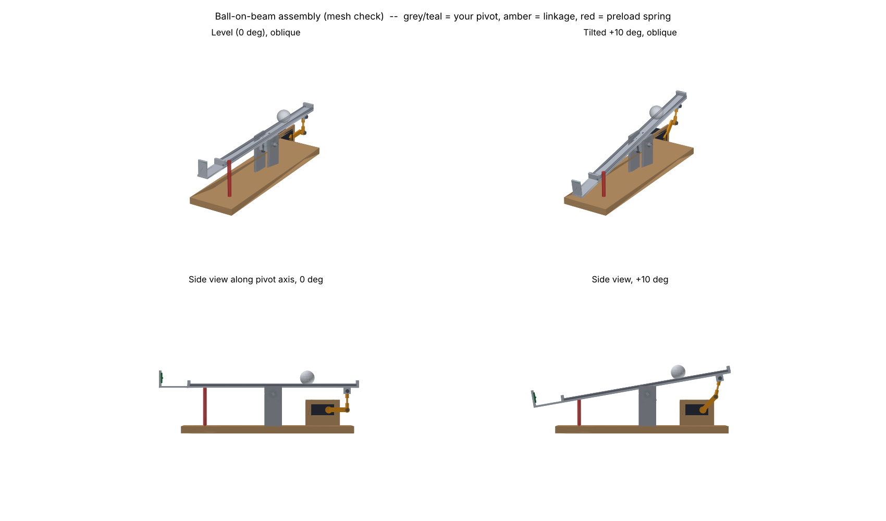
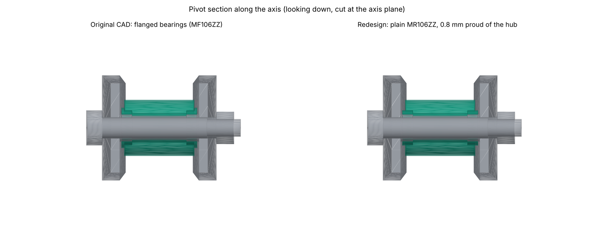

#+TITLE: Ball-on-Beam Test Platform: Part A Design Report
#+SUBTITLE: ME440 / AER440 Project 1, Fall 2026
#+DATE: Due October 20, 2026
#+LANGUAGE: en
#+OPTIONS: toc:t num:t H:3 ^:{} tex:t
#+LATEX_CLASS: article
#+LATEX_CLASS_OPTIONS: [11pt]
#+LATEX_HEADER: \usepackage[margin=1in]{geometry}
#+LATEX_HEADER: \usepackage{amsmath,amssymb,booktabs,tabularx,graphicx,float,xcolor,siunitx,array}
#+LATEX_HEADER: \usepackage[colorlinks=true,linkcolor=blue!50!black,urlcolor=blue!50!black]{hyperref}
#+LATEX_HEADER: \usepackage{caption}
#+LATEX_HEADER: \newcommand{\todo}[1]{\textcolor{red}{[TODO: #1]}}
#+LATEX_HEADER: \newcolumntype{Y}{>{\raggedright\arraybackslash}X}
#+LATEX_HEADER: \setlength{\parskip}{0.5em}\setlength{\parindent}{0pt}

# ------------------------------------------------------------------
# BUILD:  open in Emacs, C-c C-e l p    (export to LaTeX and compile PDF)
# Needs a LaTeX install (pdflatex). Keep the PNG/PDF figures next to this file.
# Red [TODO: ...] marks things only YOU or the group can fill in.
# ------------------------------------------------------------------

- Summary
This report covers Part A of Project 1: the nominal dynamics, a rough design with the reasoning behind it, a discussion of how the real system will differ from the nominal model, a detailed drawing and wiring schematic, and the parts list.

The platform is a *ball on a 300 mm beam* balanced about a *center pivot*. An Arduino Mega 2560 reads a VL53L1X time-of-flight sensor (ball position) and drives a hobby servo through a short linkage. Control is designed in Simulink. The nominal model is a double integrator with gain $5g/7 \approx 7.0\ \mathrm{m/s^2/rad}$. Because the ball rides on two rails, we expect the real gain to be about 11\% lower, $\approx 6.26\ \mathrm{m/s^2/rad}$, which we will measure and report in Part B.

#+NAME: tab:keynumbers
#+CAPTION: Key design numbers.
#+ATTR_LATEX: :environment tabularx :width 0.9\textwidth :align lY
| Quantity                                     | Value                                              |
|--------------------------------+----------------------------------------------------|
| Beam length                                  | 300 mm (from the project statement)                |
| Ball                                         | 25.4 mm (1 in) steel sphere, $R = 12.7$ mm          |
| Rails                                        | two 4 mm rods, 16 mm apart                         |
| Tilt range (design choice)                   | $\pm 10^\circ$ (our assumption, not in the spec)   |
| Servo horn / rod / lever                     | 32 mm / about 33 mm / 130 mm from the pivot        |
| Horn-to-beam angle ratio                     | about 4:1                                          |
| Nominal plant gain $5g/7$                    | 7.01 m/s$^2$ per rad                               |
| Expected gain on rails                       | 6.26 m/s$^2$ per rad ($0.638\,g$)                  |

- Nominal dynamics
** Assumptions
1. The ball is a uniform solid sphere of mass $m$ and radius $R$, with moment of inertia $J = \tfrac{2}{5} m R^2$.
2. The ball rolls without slipping.
3. The beam angle $\theta$ is small and is commanded directly (the servo is treated as a zero-order gain, no dynamics).
4. Friction losses, air drag and the beam's own inertia are neglected. The pivot is at the beam center, so gravity on the beam produces no torque about the pivot.

** Equation of motion
Let $x$ be the ball position along the beam, measured from the pivot, and $\theta$ the beam angle. Along the beam, Newton's second law gives
\begin{equation}
m\ddot{x} = m g \sin\theta - f,
\label{eq:newton}
\end{equation}
where $f$ is the friction force at the contact. About the ball's center, the torque balance is
\begin{equation}
f R = J \alpha, \qquad \alpha = \frac{\ddot{x}}{R}\ \ (\text{rolling without slipping}),
\label{eq:torque}
\end{equation}
so $f = J\ddot{x}/R^2$. Substituting into (\ref{eq:newton}),
\begin{equation}
\left(m + \frac{J}{R^2}\right)\ddot{x} = m g \sin\theta
\;\;\Longrightarrow\;\;
\ddot{x} = \frac{g\sin\theta}{1 + J/(mR^2)} = \frac{5}{7}\, g \sin\theta .
\label{eq:nonlinear}
\end{equation}
(If the beam rotates, there is an additional term $\tfrac{5}{7}\,x\dot\theta^{2}$ from the beam's rotation. It is second order in the small angular rate and we neglect it.)

** Linearization and transfer function
For small $\theta$, $\sin\theta \approx \theta$:
\begin{equation}
\ddot{x} \approx \frac{5g}{7}\,\theta,
\qquad
\frac{X(s)}{\Theta(s)} = \frac{5g/7}{s^{2}} = \frac{7.01}{s^{2}}\ \ \mathrm{m/(rad\cdot s^{2})}.
\label{eq:tf}
\end{equation}
This is a *double integrator*: no damping and no restoring force, so the open loop is not stable. A feedback controller on the measured position is required. In state form with $\mathbf{z} = [x,\ \dot{x}]^{T}$ and input $\theta$,
\begin{equation}
\dot{\mathbf z} = \begin{bmatrix}0 & 1\\ 0 & 0\end{bmatrix}\mathbf z + \begin{bmatrix}0\\ 5g/7\end{bmatrix}\theta,
\qquad y = \begin{bmatrix}1 & 0\end{bmatrix}\mathbf z .
\end{equation}

** Actuator relation
The servo sets the horn angle $\phi$ from the command. The horn drives the beam through a rod, so over a small range
\begin{equation}
\theta \approx \frac{R_h}{L}\,\phi \approx \frac{32}{130}\,\phi \approx \frac{\phi}{4.06},
\end{equation}
with horn length $R_h = 32$ mm and lever $L = 130$ mm. The overall model from servo command $u$ to ball position is therefore $X(s)/U(s) = K\,(5g/7)/s^{2}$ with $K$ the (measured) command-to-beam-angle gain.

- Rough design and reasoning
** Concept
#+NAME: fig:overview
#+CAPTION: Side view (half-section) and end view at the pivot, rendered directly from the 3D model. Numbers refer to the legend under the figure.
#+ATTR_LATEX: :width \textwidth :placement [H]

The beam is balanced on a *center pivot*. The servo only has to tilt the beam against friction and the ball's torque, not lift the beam's weight, and the dynamics are symmetric in both directions. The price is a longer lever (130 mm) from the pivot to the servo linkage.

#+NAME: fig:assembly
#+CAPTION: Assembly at level and at $+10^\circ$ (oblique and side views).
#+ATTR_LATEX: :width \textwidth :placement [H]

** Subsystems and the reason for each choice
#+ATTR_LATEX: :environment tabularx :width \textwidth :align lYY
| Subsystem | Choice | Reason |
|-----------+--------+--------|
| Beam | 20 mm spine with two 4 mm rails 16 mm apart, 300 mm long | The rails keep the ball on the beam and give a repeatable rolling geometry. |
| Pivot | M5 shoulder bolt, two MR106ZZ bearings (6x10x3), spacer sleeve, 0.5 mm shims, rotating hub, nylon-lock nut | Bearings give low, repeatable friction. A shoulder bolt gives a precise bearing seat. The nylon-lock nut holds preload without loosening. |
| Actuator | Hobby servo, 32 mm horn, rod with rod-end bearings | Rod ends remove printed-joint wear. The 4:1 lever ratio divides joint slop by about 4 at the beam. |
| Sensing | VL53L1X ToF on a short arm past the sensor-end stop | Non-contact position measurement over the full beam, over I2C. |
| Controller | Arduino Mega 2560 + Simulink support package | Required by the project interface. |
| Power | Servo from the bench 5 V supply, grounds common with the Arduino | Servo stall current can exceed what the Arduino 5 V pin can supply. |

** Pivot assembly
The pivot uses plain (unflanged) MR106ZZ bearings, so the hub was designed with a middle bore and seats for plain bearings. They sit 0.8 mm proud of each hub face, which is why 0.5 mm shims and a sleeve set the spacing against the uprights.

#+NAME: fig:pivot
#+CAPTION: Pivot section with flanged versus plain bearings. We ordered plain bearings and redesigned the hub accordingly.
#+ATTR_LATEX: :width 0.9\textwidth :placement [H]

** Linkage kinematics
The horn is 32 mm, the rod about 33 mm, and the rod joint is 130 mm from the pivot. For a beam angle of $\pm 10^\circ$ the horn must turn from about $-42.9^\circ$ to $+46.7^\circ$, which is about $10\%$ asymmetric, so the beam angle is *not* exactly linear in the servo command. Slop is divided by the lever ratio: for example, 0.2 mm of play at the horn joint is $0.2/130\ \mathrm{rad} \approx 0.09^\circ$ at the beam. A preload spring keeps the joints loaded in one direction so the joint does not rattle.

** Clearances checked
Over the full $\pm 10^\circ$ sweep in the CAD model, the minimum gaps are:

#+ATTR_LATEX: :environment tabularx :width 0.7\textwidth :align lY
| Pair                    | Minimum gap |
|-------------------------+-------------|
| Horn to servo body      | 1.00 mm     |
| Spine to uprights       | 1.30 mm     |
| Rails to uprights       | 1.32 mm     |
| Ball to uprights        | 3.7 mm      |

The tilt range of $\pm 10^\circ$ is our design choice. @@latex:\todo{confirm the spec does not require a different range}@@

- Nominal versus actual
** Summary of differences
#+ATTR_LATEX: :environment tabularx :width \textwidth :align lYY
| Effect | Nominal model | Expected reality |
|--------+---------------+------------------|
| Ball rolls on two rails | $\ddot{x} = 0.714\,g\sin\theta$ | $0.638\,g\sin\theta$, about 11\% lower |
| Servo | $\theta = K u$, no dynamics | Unknown $K$, small deadband, finite bandwidth, load-dependent |
| Linkage | linear in command | about 10\% non-linear over $\pm 10^\circ$ |
| Slop | none | joint and pivot play, divided by the lever ratio |
| Friction | none | bearing friction and rolling resistance on the rails |
| Sensor | exact position | quantization, noise, finite sample rate, field of view clips the stops |
| Beam angle | known | not measured, inferred from the servo command |

** Ball on two rails
The ball touches the two rails at points $s/2 = 8$ mm either side of the beam centerline. The rail centers are at distance $R + r = 14.7$ mm from the ball center ($r = 2$ mm rail radius). The perpendicular distance from the ball's rolling axis to the contact points is the effective rolling radius
\begin{equation}
r_{\mathrm{eff}} = R\sqrt{1 - \left(\frac{s/2}{R+r}\right)^{2}} = 12.7\sqrt{1 - \left(\frac{8}{14.7}\right)^{2}} = 10.65\ \mathrm{mm}.
\end{equation}
Rolling on this smaller radius increases the effective rotational inertia: with $\omega = v / r_{\mathrm{eff}}$,
\begin{equation}
\ddot{x} = \frac{g\sin\theta}{1 + \dfrac{2}{5}\left(\dfrac{R}{r_{\mathrm{eff}}}\right)^{2}} = 0.638\,g\sin\theta ,
\end{equation}
compared with $0.714\,g\sin\theta$ for a sphere on a flat surface. The plant gain is therefore about $0.638/0.714 = 0.89$ of nominal, i.e. $6.26$ instead of $7.01\ \mathrm{m/s^{2}/rad}$. We will measure this in Part B.

** Servo and linkage
The servo converts command to horn angle with an unknown gain and a small deadband, and has finite speed. We treat it as an ideal gain for design, then check that the control bandwidth is well below the servo's. The linkage adds a mild non-linearity (about 10\% asymmetry across $\pm 10^\circ$). If it matters, we calibrate command to beam angle with a lookup table or a fitted polynomial.

** Friction, slop and mitigation
Bearing friction and rolling resistance add a damping-like and a stick-slip effect that the nominal model lacks. Slop between servo and beam appears as a dead zone in the loop and can cause a small limit cycle with integral action. We mitigate by using rod-end bearings instead of printed joints, a preload spring, a 4:1 lever ratio that divides slop at the beam, and smooth, hard rails.

** Sensor
The VL53L1X has a minimum range of about 40 mm. The nearest ball surface to the sensor is 47 mm, so the full beam is measurable. Its 27$^\circ$ field of view clips the end stop and the rails, so we will narrow the region of interest (ROI) in software. A chrome ball may reflect poorly, so we will test it and use matte tape if needed. The measurement rate (set by the sensor's timing budget) limits how fast the loop can run. @@latex:\todo{confirm sensor sample rate once tested}@@ We also need to confirm the TOF400C board tolerates 5 V logic before wiring it to the Mega.

- Detailed design: wiring
Servo power comes from the bench 5 V supply, not the Arduino 5 V pin, and the supply ground is tied to the Arduino ground.

#+ATTR_LATEX: :environment tabularx :width \textwidth :align lYY
| Signal | From | To (Arduino Mega) |
|--------+------+-------------------|
| ToF VIN | sensor | 5V |
| ToF GND | sensor | GND |
| ToF SDA | sensor | pin 20 |
| ToF SCL | sensor | pin 21 |
| Servo signal | servo | pin 9 (PWM) |
| Servo power | bench supply 5 V | servo (not the Arduino 5 V) |
| Common ground | supply (-) | Arduino GND |

#+NAME: fig:schematic
#+CAPTION: Wiring schematic generated with schemdraw.
#+BEGIN_EXPORT latex
\begin{figure}[H]
\centering
\IfFileExists{ball_on_beam_schematic.pdf}{%
  \includegraphics[width=\textwidth]{ball_on_beam_schematic.pdf}}{%
  \fbox{\parbox{0.9\textwidth}{\todo{generate ball\_on\_beam\_schematic.pdf: in ball\_on\_beam\_schematic.py change the last save line to d.save("ball\_on\_beam\_schematic.pdf") and run it}}}}
\caption{Wiring schematic (generated with schemdraw).}
\end{figure}
#+END_EXPORT

- Parts list
Status: *ordered* means the group member has already bought it, *to buy* is still open. Replace each red link placeholder with the link from your order confirmation.

#+ATTR_LATEX: :environment tabularx :width \textwidth :align llYll
| Item | Qty | Spec / purpose | Link | Status |
|------+-----+----------------+------+--------|
| Arduino Mega 2560 | 1 | controller | @@latex:\todo{link}@@ | @@latex:\todo{confirm}@@ |
| VL53L1X ToF breakout (TOF400C) | 1 | position sensor, I2C | @@latex:\todo{link}@@ | @@latex:\todo{confirm}@@ |
| Hobby servo | 1 | beam actuator (see options below) | @@latex:\todo{link}@@ | to buy |
| MR106ZZ bearings 6x10x3 | 2 | pivot, plain (unflanged) | @@latex:\todo{link}@@ | ordered |
| M5 shoulder bolt, 6 mm x 30 mm shoulder | 1 | pivot axle | @@latex:\todo{link}@@ | @@latex:\todo{confirm}@@ |
| M5 nylon-lock nut | 1 | pivot preload | @@latex:\todo{link}@@ | @@latex:\todo{confirm}@@ |
| Spacer sleeve, 7 / 6.1 mm, 15.6 mm long | 1 | bearing spacing | @@latex:\todo{link}@@ | to buy or make |
| 0.5 mm shims | 2 | bearing spacing | @@latex:\todo{link}@@ | to buy |
| Rod-end bearings | 2 | servo-to-beam linkage | @@latex:\todo{link}@@ | @@latex:\todo{confirm}@@ |
| Preload spring | 1 | removes linkage backlash | @@latex:\todo{link}@@ | to buy |
| 4 mm rod, 300 mm long | 2 | rails | @@latex:\todo{link, or print}@@ | to buy |
| M3 hardware set | 1 | servo and linkage | @@latex:\todo{link}@@ | to buy |
| Servo power leads / connector | 1 | supply to servo | @@latex:\todo{link}@@ | to buy |
| KY-040 rotary encoder with knob | 1 | optional gain knob | @@latex:\todo{link}@@ | ordered |
| Bench 5 V supply | 1 | servo power | provided in lab | in lab |
| Base, uprights, spine, servo plates | n/a | fabricated (wood / aluminum / 3D print) | n/a | to make |

** Servo options
The load is light (a ball and a light beam), so a mid-range servo is enough. We have not chosen one yet. @@latex:\todo{group decision}@@

#+ATTR_LATEX: :environment tabularx :width 0.8\textwidth :align lrY
| Option | Price | Note |
|--------+-------+------|
| Hitec HS-5645MG | \$59.96 | strongest of the three |
| Savox micro | \$38.13 | middle |
| Hitec HS-5055MG | \$29.99 | cheapest, adequate for this load |

The LCD screen and the rotary encoder are probably not needed because gains are tuned from Simulink. @@latex:\todo{decide: drop the LCD}@@

- Open items
1. Choose and order the servo.
2. Buy the sleeve, M3 hardware and servo leads.
3. Verify the tube length and outer diameter, shoulder-bolt size and shim thickness against the parts that arrive.
4. Test the ToF sensor (ROI, ball reflectivity, 5 V tolerance, sample rate).
5. Decide whether the rails are printed or steel/carbon rod.
6. Confirm the $\pm 10^\circ$ tilt range against the project statement.
7. Fill in all parts-list links.

#+TITLE: Ball-on-Beam Test Platform: Part A Design Report
#+SUBTITLE: ME440 / AER440 Project 1, Fall 2026
#+DATE: Due October 20, 2026
#+LANGUAGE: en
#+OPTIONS: toc:t num:t H:3 ^:{} tex:t
#+LATEX_CLASS: article
#+LATEX_CLASS_OPTIONS: [11pt]
#+LATEX_HEADER: \usepackage[margin=1in]{geometry}
#+LATEX_HEADER: \usepackage{amsmath,amssymb,booktabs,tabularx,graphicx,float,xcolor,siunitx,array}
#+LATEX_HEADER: \usepackage[colorlinks=true,linkcolor=blue!50!black,urlcolor=blue!50!black]{hyperref}
#+LATEX_HEADER: \usepackage{caption}
#+LATEX_HEADER: \newcommand{\todo}[1]{\textcolor{red}{[TODO: #1]}}
#+LATEX_HEADER: \newcolumntype{Y}{>{\raggedright\arraybackslash}X}
#+LATEX_HEADER: \setlength{\parskip}{0.5em}\setlength{\parindent}{0pt}

# ------------------------------------------------------------------
# BUILD:  open in Emacs, C-c C-e l p   (export to LaTeX and compile PDF)
# Needs a LaTeX install (pdflatex). Keep the PNG/PDF figures next to this file.
# Red [TODO: ...] marks things only YOU or the group can fill in.
# ------------------------------------------------------------------

* Summary
This report covers Part A of Project 1: the nominal dynamics, a rough design with the reasoning behind it, a discussion of how the real system will differ from the nominal model, a detailed drawing and wiring schematic, and the parts list.

The platform is a *ball on a 300 mm beam* balanced about a *center pivot*. An Arduino Mega 2560 reads a VL53L1X time-of-flight sensor (ball position) and drives a hobby servo through a short linkage. Control is designed in Simulink. The nominal model is a double integrator with gain $5g/7 \approx 7.0\ \mathrm{m/s^2/rad}$. Because the ball rides on two rails, we expect the real gain to be about 11\% lower, $\approx 6.26\ \mathrm{m/s^2/rad}$, which we will measure and report in Part B.

#+NAME: tab:keynumbers
#+CAPTION: Key design numbers.
#+ATTR_LATEX: :environment tabularx :width 0.9\textwidth :align lY
| Quantity                       | Value                                              |
|--------------------------------+----------------------------------------------------|
| Beam length                    | 300 mm (from the project statement)                |
| Ball                           | 25.4 mm (1 in) steel sphere, $R = 12.7$ mm          |
| Rails                          | two 4 mm rods, 16 mm apart                         |
| Tilt range (design choice)     | $\pm 10^\circ$ (our assumption, not in the spec)   |
| Servo horn / rod / lever       | 32 mm / about 33 mm / 130 mm from the pivot        |
| Horn-to-beam angle ratio       | about 4:1                                          |
| Nominal plant gain $5g/7$      | 7.01 m/s$^2$ per rad                               |
| Expected gain on rails         | 6.26 m/s$^2$ per rad ($0.638\,g$)                  |

* Nominal dynamics
** Assumptions
1. The ball is a uniform solid sphere of mass $m$ and radius $R$, with moment of inertia $J = \tfrac{2}{5} m R^2$.
2. The ball rolls without slipping.
3. The beam angle $\theta$ is small and is commanded directly (the servo is treated as a zero-order gain, no dynamics).
4. Friction losses, air drag and the beam's own inertia are neglected. The pivot is at the beam center, so gravity on the beam produces no torque about the pivot.

** Equation of motion
Let $x$ be the ball position along the beam, measured from the pivot, and $\theta$ the beam angle. Along the beam, Newton's second law gives
\begin{equation}
m\ddot{x} = m g \sin\theta - f,
\label{eq:newton}
\end{equation}
where $f$ is the friction force at the contact. About the ball's center, the torque balance is
\begin{equation}
f R = J \alpha, \qquad \alpha = \frac{\ddot{x}}{R}\ \ (\text{rolling without slipping}),
\label{eq:torque}
\end{equation}
so $f = J\ddot{x}/R^2$. Substituting into (\ref{eq:newton}),
\begin{equation}
\left(m + \frac{J}{R^2}\right)\ddot{x} = m g \sin\theta
\;\;\Longrightarrow\;\;
\ddot{x} = \frac{g\sin\theta}{1 + J/(mR^2)} = \frac{5}{7}\, g \sin\theta .
\label{eq:nonlinear}
\end{equation}
(If the beam rotates, there is an additional term $\tfrac{5}{7}\,x\dot\theta^{2}$ from the beam's rotation. It is second order in the small angular rate and we neglect it.)

** Linearization and transfer function
For small $\theta$, $\sin\theta \approx \theta$:
\begin{equation}
\ddot{x} \approx \frac{5g}{7}\,\theta,
\qquad
\frac{X(s)}{\Theta(s)} = \frac{5g/7}{s^{2}} = \frac{7.01}{s^{2}}\ \ \mathrm{m/(rad\cdot s^{2})}.
\label{eq:tf}
\end{equation}
This is a *double integrator*: no damping and no restoring force, so the open loop is not stable. A feedback controller on the measured position is required. In state form with $\mathbf{z} = [x,\ \dot{x}]^{T}$ and input $\theta$,
\begin{equation}
\dot{\mathbf z} = \begin{bmatrix}0 & 1\\ 0 & 0\end{bmatrix}\mathbf z + \begin{bmatrix}0\\ 5g/7\end{bmatrix}\theta,
\qquad y = \begin{bmatrix}1 & 0\end{bmatrix}\mathbf z .
\end{equation}

** Actuator relation
The servo sets the horn angle $\phi$ from the command. The horn drives the beam through a rod, so over a small range
\begin{equation}
\theta \approx \frac{R_h}{L}\,\phi \approx \frac{32}{130}\,\phi \approx \frac{\phi}{4.06},
\end{equation}
with horn length $R_h = 32$ mm and lever $L = 130$ mm. The overall model from servo command $u$ to ball position is therefore $X(s)/U(s) = K\,(5g/7)/s^{2}$ with $K$ the (measured) command-to-beam-angle gain.

* Rough design and reasoning
** Concept
#+NAME: fig:overview
#+CAPTION: Side view (half-section) and end view at the pivot, rendered directly from the 3D model. Numbers refer to the legend under the figure.
#+ATTR_LATEX: :width \textwidth :placement [H]

The beam is balanced on a *center pivot*. The servo only has to tilt the beam against friction and the ball's torque, not lift the beam's weight, and the dynamics are symmetric in both directions. The price is a longer lever (130 mm) from the pivot to the servo linkage.

#+NAME: fig:assembly
#+CAPTION: Assembly at level and at $+10^\circ$ (oblique and side views).
#+ATTR_LATEX: :width \textwidth :placement [H]

** Subsystems and the reason for each choice
#+ATTR_LATEX: :environment tabularx :width \textwidth :align lYY
| Subsystem | Choice | Reason |
|-----------+--------+--------|
| Beam | 20 mm spine with two 4 mm rails 16 mm apart, 300 mm long | The rails keep the ball on the beam and give a repeatable rolling geometry. |
| Pivot | M5 shoulder bolt, two MR106ZZ bearings (6x10x3), spacer sleeve, 0.5 mm shims, rotating hub, nylon-lock nut | Bearings give low, repeatable friction. A shoulder bolt gives a precise bearing seat. The nylon-lock nut holds preload without loosening. |
| Actuator | Hobby servo, 32 mm horn, rod with rod-end bearings | Rod ends remove printed-joint wear. The 4:1 lever ratio divides joint slop by about 4 at the beam. |
| Sensing | VL53L1X ToF on a short arm past the sensor-end stop | Non-contact position measurement over the full beam, over I2C. |
| Controller | Arduino Mega 2560 + Simulink support package | Required by the project interface. |
| Power | Servo from the bench 5 V supply, grounds common with the Arduino | Servo stall current can exceed what the Arduino 5 V pin can supply. |

** Pivot assembly
The pivot uses plain (unflanged) MR106ZZ bearings, so the hub was designed with a middle bore and seats for plain bearings. They sit 0.8 mm proud of each hub face, which is why 0.5 mm shims and a sleeve set the spacing against the uprights.

#+NAME: fig:pivot
#+CAPTION: Pivot section with flanged versus plain bearings. We ordered plain bearings and redesigned the hub accordingly.
#+ATTR_LATEX: :width 0.9\textwidth :placement [H]

** Linkage kinematics
The horn is 32 mm, the rod about 33 mm, and the rod joint is 130 mm from the pivot. For a beam angle of $\pm 10^\circ$ the horn must turn from about $-42.9^\circ$ to $+46.7^\circ$, which is about $10\%$ asymmetric, so the beam angle is *not* exactly linear in the servo command. Slop is divided by the lever ratio: for example, 0.2 mm of play at the horn joint is $0.2/130\ \mathrm{rad} \approx 0.09^\circ$ at the beam. A preload spring keeps the joints loaded in one direction so the joint does not rattle.

** Clearances checked
Over the full $\pm 10^\circ$ sweep in the CAD model, the minimum gaps are:

#+ATTR_LATEX: :environment tabularx :width 0.7\textwidth :align lY
| Pair                    | Minimum gap |
|-------------------------+-------------|
| Horn to servo body      | 1.00 mm     |
| Spine to uprights       | 1.30 mm     |
| Rails to uprights       | 1.32 mm     |
| Ball to uprights        | 3.7 mm      |

The tilt range of $\pm 10^\circ$ is our design choice. @@latex:\todo{confirm the spec does not require a different range}@@

* Nominal versus actual
** Summary of differences
#+ATTR_LATEX: :environment tabularx :width \textwidth :align lYY
| Effect | Nominal model | Expected reality |
|--------+---------------+------------------|
| Ball rolls on two rails | $\ddot{x} = 0.714\,g\sin\theta$ | $0.638\,g\sin\theta$, about 11\% lower |
| Servo | $\theta = K u$, no dynamics | Unknown $K$, small deadband, finite bandwidth, load-dependent |
| Linkage | linear in command | about 10\% non-linear over $\pm 10^\circ$ |
| Slop | none | joint and pivot play, divided by the lever ratio |
| Friction | none | bearing friction and rolling resistance on the rails |
| Sensor | exact position | quantization, noise, finite sample rate, field of view clips the stops |
| Beam angle | known | not measured, inferred from the servo command |

** Ball on two rails
The ball touches the two rails at points $s/2 = 8$ mm either side of the beam centerline. The rail centers are at distance $R + r = 14.7$ mm from the ball center ($r = 2$ mm rail radius). The perpendicular distance from the ball's rolling axis to the contact points is the effective rolling radius
\begin{equation}
r_{\mathrm{eff}} = R\sqrt{1 - \left(\frac{s/2}{R+r}\right)^{2}} = 12.7\sqrt{1 - \left(\frac{8}{14.7}\right)^{2}} = 10.65\ \mathrm{mm}.
\end{equation}
Rolling on this smaller radius increases the effective rotational inertia: with $\omega = v / r_{\mathrm{eff}}$,
\begin{equation}
\ddot{x} = \frac{g\sin\theta}{1 + \dfrac{2}{5}\left(\dfrac{R}{r_{\mathrm{eff}}}\right)^{2}} = 0.638\,g\sin\theta ,
\end{equation}
compared with $0.714\,g\sin\theta$ for a sphere on a flat surface. The plant gain is therefore about $0.638/0.714 = 0.89$ of nominal, i.e. $6.26$ instead of $7.01\ \mathrm{m/s^{2}/rad}$. We will measure this in Part B.

** Servo and linkage
The servo converts command to horn angle with an unknown gain and a small deadband, and has finite speed. We treat it as an ideal gain for design, then check that the control bandwidth is well below the servo's. The linkage adds a mild non-linearity (about 10\% asymmetry across $\pm 10^\circ$). If it matters, we calibrate command to beam angle with a lookup table or a fitted polynomial.

** Friction, slop and mitigation
Bearing friction and rolling resistance add a damping-like and a stick-slip effect that the nominal model lacks. Slop between servo and beam appears as a dead zone in the loop and can cause a small limit cycle with integral action. We mitigate by using rod-end bearings instead of printed joints, a preload spring, a 4:1 lever ratio that divides slop at the beam, and smooth, hard rails.

** Sensor
The VL53L1X has a minimum range of about 40 mm. The nearest ball surface to the sensor is 47 mm, so the full beam is measurable. Its 27$^\circ$ field of view clips the end stop and the rails, so we will narrow the region of interest (ROI) in software. A chrome ball may reflect poorly, so we will test it and use matte tape if needed. The measurement rate (set by the sensor's timing budget) limits how fast the loop can run. @@latex:\todo{confirm sensor sample rate once tested}@@ We also need to confirm the TOF400C board tolerates 5 V logic before wiring it to the Mega.

* Detailed design: wiring
Servo power comes from the bench 5 V supply, not the Arduino 5 V pin, and the supply ground is tied to the Arduino ground.

#+ATTR_LATEX: :environment tabularx :width \textwidth :align lYY
| Signal | From | To (Arduino Mega) |
|--------+------+-------------------|
| ToF VIN | sensor | 5V |
| ToF GND | sensor | GND |
| ToF SDA | sensor | pin 20 |
| ToF SCL | sensor | pin 21 |
| Servo signal | servo | pin 9 (PWM) |
| Servo power | bench supply 5 V | servo (not the Arduino 5 V) |
| Common ground | supply (-) | Arduino GND |

#+NAME: fig:schematic
#+CAPTION: Wiring schematic generated with schemdraw.
#+BEGIN_EXPORT latex
\begin{figure}[H]
\centering
\IfFileExists{ball_on_beam_schematic.pdf}{%
  \includegraphics[width=\textwidth]{ball_on_beam_schematic.pdf}}{%
  \fbox{\parbox{0.9\textwidth}{\todo{generate ball\_on\_beam\_schematic.pdf: in ball\_on\_beam\_schematic.py change the last save line to d.save("ball\_on\_beam\_schematic.pdf") and run it}}}}
\caption{Wiring schematic (generated with schemdraw).}
\end{figure}
#+END_EXPORT

* Parts list
Status: *ordered* means the group member has already bought it, *to buy* is still open. Replace each red link placeholder with the link from your order confirmation.

#+ATTR_LATEX: :environment tabularx :width \textwidth :align llYll
| Item | Qty | Spec / purpose | Link | Status |
|------+-----+----------------+------+--------|
| Arduino Mega 2560 | 1 | controller | @@latex:\todo{link}@@ | @@latex:\todo{confirm}@@ |
| VL53L1X ToF breakout (TOF400C) | 1 | position sensor, I2C | @@latex:\todo{link}@@ | @@latex:\todo{confirm}@@ |
| Hobby servo | 1 | beam actuator (see options below) | @@latex:\todo{link}@@ | to buy |
| MR106ZZ bearings 6x10x3 | 2 | pivot, plain (unflanged) | @@latex:\todo{link}@@ | ordered |
| M5 shoulder bolt, 6 mm x 30 mm shoulder | 1 | pivot axle | @@latex:\todo{link}@@ | @@latex:\todo{confirm}@@ |
| M5 nylon-lock nut | 1 | pivot preload | @@latex:\todo{link}@@ | @@latex:\todo{confirm}@@ |
| Spacer sleeve, 7 / 6.1 mm, 15.6 mm long | 1 | bearing spacing | @@latex:\todo{link}@@ | to buy or make |
| 0.5 mm shims | 2 | bearing spacing | @@latex:\todo{link}@@ | to buy |
| Rod-end bearings | 2 | servo-to-beam linkage | @@latex:\todo{link}@@ | @@latex:\todo{confirm}@@ |
| Preload spring | 1 | removes linkage backlash | @@latex:\todo{link}@@ | to buy |
| 4 mm rod, 300 mm long | 2 | rails | @@latex:\todo{link, or print}@@ | to buy |
| M3 hardware set | 1 | servo and linkage | @@latex:\todo{link}@@ | to buy |
| Servo power leads / connector | 1 | supply to servo | @@latex:\todo{link}@@ | to buy |
| KY-040 rotary encoder with knob | 1 | optional gain knob | @@latex:\todo{link}@@ | ordered |
| Bench 5 V supply | 1 | servo power | provided in lab | in lab |
| Base, uprights, spine, servo plates | n/a | fabricated (wood / aluminum / 3D print) | n/a | to make |

** Servo options
The load is light (a ball and a light beam), so a mid-range servo is enough. We have not chosen one yet. @@latex:\todo{group decision}@@

#+ATTR_LATEX: :environment tabularx :width 0.8\textwidth :align lrY
| Option | Price | Note |
|--------+-------+------|
| Hitec HS-5645MG | \$59.96 | strongest of the three |
| Savox micro | \$38.13 | middle |
| Hitec HS-5055MG | \$29.99 | cheapest, adequate for this load |

The LCD screen and the rotary encoder are probably not needed because gains are tuned from Simulink. @@latex:\todo{decide: drop the LCD}@@

* Open items
1. Choose and order the servo.
2. Buy the sleeve, M3 hardware and servo leads.
3. Verify the tube length and outer diameter, shoulder-bolt size and shim thickness against the parts that arrive.
4. Test the ToF sensor (ROI, ball reflectivity, 5 V tolerance, sample rate).
5. Decide whether the rails are printed or steel/carbon rod.
6. Confirm the $\pm 10^\circ$ tilt range against the project statement.
7. Fill in all parts-list links.
